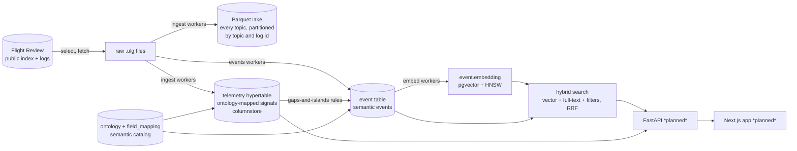
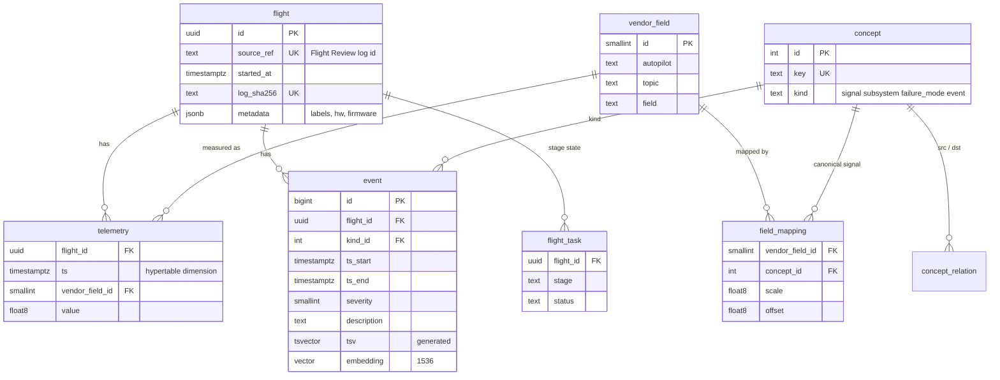
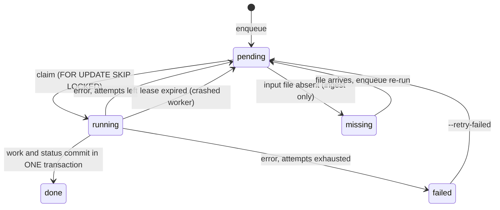
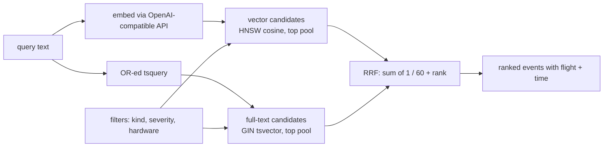
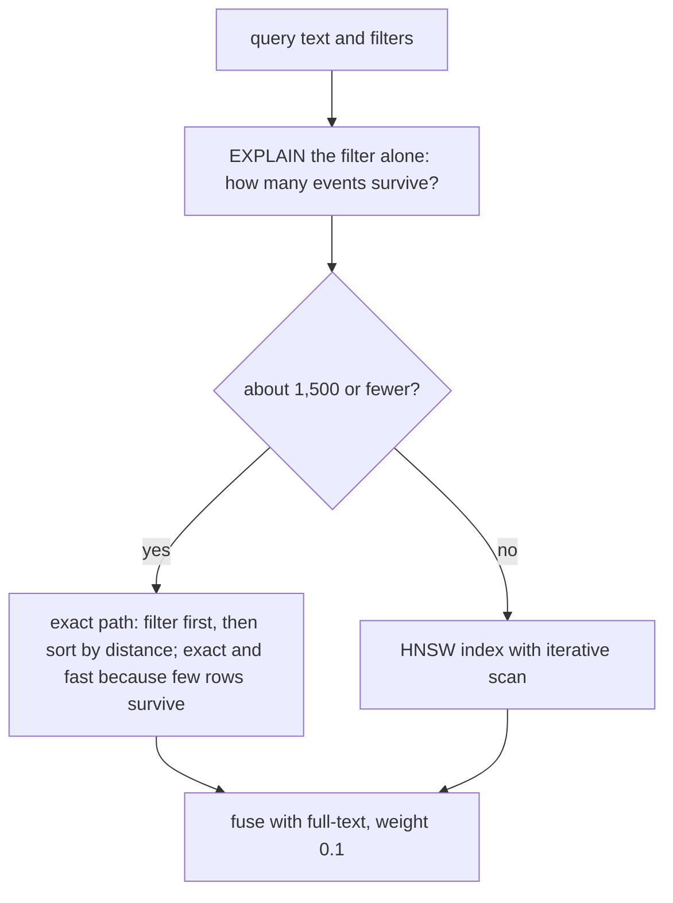
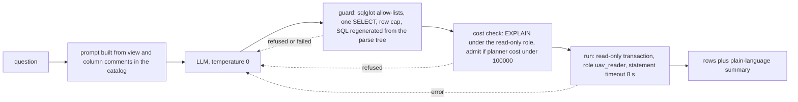
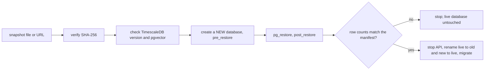

# Architecture

Status: describes what is implemented. Planned parts are marked *(planned)*.

## 1. Data flow

All boxes inside Postgres are one database; the Parquet lake is the full-fidelity raw layer and the benchmark
comparator source (DuckDB). Only ~34 ontology-mapped signals go into the hypertable (decision D2).

## 2. Schema

Semantic layer: `canonical_telemetry` is a view that joins `telemetry` to `field_mapping` and `concept`, applying each
mapping's scale and offset, so queries are written against canonical signal names (`battery.remaining`)
instead of vendor fields (`battery_status.remaining`). Ontology: signal `part_of` subsystem, signal `indicates`
failure mode, event `indicates` failure mode (queried with recursive CTEs *(planned)*).

## 3. Pipeline and job queues

Every stage is idempotent, retried, crash-recoverable, and safe to run concurrently.

| Stage | Queue table | Script | Output |
|---|---|---|---|
| ingest | `ingest_job` (per log) | `scripts/ingest.py` | Parquet + `flight` + `telemetry` |
| events | `flight_task` stage `events` | `scripts/events.py` | `event` rows |
| embed_events | `flight_task` stage `embed_events` | `scripts/embed_events.py` | `event.embedding` |
| compress | none (chunk state) | `scripts/compress.py` | columnstore chunks |

Orchestration: `bin/uavlog` (single entry point; `stream` overlaps download, ingest, events and compression so a
large run never needs the uncompressed footprint).

## 4. Hybrid search

Filters run inside each candidate query. pgvector applies filters after the ANN scan, so a selective filter can leave fewer than k rows. Experiment 3
(D18) measured the alternatives, and the planner itself chooses the wrong path at 10% selectivity, so the search routes by the planner's row estimate for the
filter alone:

## 5. API

FastAPI (`app/api`), connection pool, autocommit, one shared LLM client. OpenAPI docs at `/docs`.

| Endpoint | Purpose |
|---|---|
| `GET /api/flights` | flight list with event counts, labels, filters (`hw`, `label`, paging) |
| `GET /api/flights/{id}` | metadata, all events (offsets in seconds from takeoff of the log), available signals |
| `GET /api/flights/{id}/signals/{signal}` | min/max/mean envelope per time bucket, computed in the database (`time_bucket` over `canonical_telemetry`); envelopes, not decimation, so safety spikes survive |
| `GET /api/search` | hybrid event search (`q`, `k`, `kind`, `min_severity`, `hw`, `mode`) |
| `GET /api/ontology` | concepts and relations |
| `GET /api/flights/{id}/similar` | flights that behaved most like this one (cosine distance between 32-dimension behavioural signatures) |
| `GET /api/flights/{id}/track` | ground track in local metres, one point per second, with the mode segments that colour it |
| `GET/POST /api/flights/{id}/notes`, `DELETE /api/notes/{id}` | investigation notes pinned to a moment (writes can be disabled with `ALLOW_WRITES=0`) |
| `GET /api/pipeline` | queue counts, recent failures with errors, freshness of derived tables |
| `GET /api/bench`, `GET /api/bench/{file}` | benchmark result files (strict name whitelist) |
| `GET /api/stats`, `GET /health` | counts and liveness |

Zoomed-out envelopes are served from `telemetry_1s`, a continuous aggregate of one row per second per flight and signal, and fall back to the raw hypertable at fine zoom. Every route is rate limited per client (the limiter trusts `X-Forwarded-For` only from a private peer). Measured on the dev corpus: envelope queries 0.19 to 0.26 s on compressed chunks (up to 106k samples per signal);
search about 1.4 s, dominated by the embedding API round trip. *Planned:* query-embedding cache, read-only DB role for
the API, NL-to-SQL endpoint with guardrails, DB-internals endpoint (`EXPLAIN`, index and chunk stats).

## 6. NL-to-SQL

`semantic.*` views are the only objects the role can read: flights, events, signals, telemetry, ontology, and `signal_summary` (a materialized
per-flight min/max/mean refreshed after ingest). Refusals and errors are fed back to the model for up to two repair rounds. Evidence: 19 security and
pipeline tests, and the three-condition accuracy experiment in `docs/decisions.md` D16 (`bench/results/nlsql_eval_*.md`).

## 7. Web app

Next.js 16 (App Router, Cache Components), TypeScript, Tailwind 4, TanStack Query for server state, Zustand for the shared
zoom window and selected event, uPlot for charts. The browser calls only the web origin; `/api/*` is rewritten to FastAPI, so the
same setup works on a remote server with no CORS. Design rationale and tokens: `docs/design.md`.

| Page | What it shows |
|---|---|
| Overview | search hero, flight board (modes + event marks per flight), corpus facts |
| Flights | all flights as strips, ordered by critical events, recency or length |
| Flight | overview ribbon, synchronized charts with mode shading and envelopes, event list that jumps the charts, pilot notes |
| Search | hybrid event search with filters, best-match-per-flight, collapsed duplicates, ranking details |
| Database | live compression ratio, index and table sizes, queue state, `EXPLAIN ANALYZE` of named queries |

## 8. Snapshots

`./bin/snapshot create` packs the database (zstd dump without the benchmark schema, manifest, checksum) and can upload to a folder, SSH host, S3, a GitHub
release or a presigned URL; `restore` pulls from the same places. See D17 and the README.

## 9. Deployment

`docker compose`: `db` (timescale/timescaledb-ha:pg17: TimescaleDB, pgvector, pgvectorscale), `backend` (Python 3.12
work container for pipeline stages) and `api` (uvicorn on port 8000); both run as the host uid so data files stay manageable. Data lives under `HOST_DATA_DIR`
(raw logs, Parquet, index). The same compose file and `bin/uavlog stream` run on the large machine.
