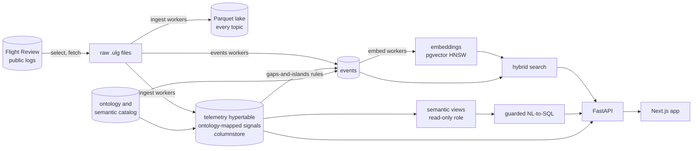

# Semantic Log Analytics for UAV Flight Logs

**A database-centred design and evaluation**

Sumit Kumar. Advanced Database Management Systems, term project. Code and data pipeline: https://github.com/SumitKumar-17/UAVLog

## Abstract

Flight controllers log dozens to hundreds of message types, some at hundreds of hertz, in vendor-specific formats, and the people who read those logs want to ask
questions in their own words: "which flights lost a motor", "show me the ones that shook". This project treats that as a database problem and builds a
platform on a single PostgreSQL instance (TimescaleDB for time series, pgvector for similarity). It stores 70.7 million telemetry samples from 300 real
PX4 flights in 0.4 GB, 32 times smaller than the same data as ordinary rows. It adds a semantic layer (an ontology that maps vendor field names to
canonical signals, failure modes and event kinds), extracts 3,401 searchable events, answers natural-language questions through a guarded read-only SQL
path, and measures each design choice. The measurements include a few results that contradicted expectations: full-text fusion did not improve search
over embeddings alone, plain rank fusion hurt it, the query planner chose a path that returned 4 of 10 requested rows for a 10% filter, and most of the
accuracy gained by a "semantic layer" for natural-language SQL came from documentation, not from the view structure. Mistakes found along the way, in
the data and in the author's own harness, are reported with their fixes.

## 1. Problem and questions

UAV logs are time series with tens of millions of rows per few hundred flights, but they are also documents (warnings, mode changes, notes) and
they come in vendor dialects: PX4 and ArduPilot name the same quantity differently and in different units. Existing viewers (Flight Review, UAV Log
Viewer, MAVExplorer, PlotJuggler, Foxglove) plot one log at a time. We found no peer-reviewed system that combines an ontology, hybrid retrieval and
guarded natural-language querying over a corpus of PX4 logs; we claim this only "to our knowledge".

Questions, each answered by an experiment:

1. **Storage.** How should high-rate telemetry be physically organised, and what does it cost? (Section 4)
2. **Retrieval.** Which vector index and which strategy for filtered search, and does full-text fusion help? (Section 6)
3. **Natural-language access.** Can a model write safe, correct SQL, and how much does a semantic layer contribute beyond documentation? (Section 7)
4. **Operations.** Can the pipeline survive bad inputs and scale from 300 to hundreds of thousands of logs? (Section 8)

## 2. Data and method

The corpus is 300 PX4 multicopter logs chosen by a seeded, stratified sample from Flight Review's public index of 478,918 logs (quadrotors, 2 to 15
minutes, 2024 onward, simulation excluded; strata: human-labelled, with logged errors, clean). They total 8.75 GB as `.ulg` files. Flight Review states
that public logs are shared under a Creative Commons Attribution licence; see `DATA_ATTRIBUTION.md`. Selection is expansion-safe: a larger tier keeps every
log already processed.

Method principles, applied throughout: measure instead of assuming; verify a claim from a fresh connection or a real log before relying on it; keep
development and held-out evaluation sets separate; report intervals and paired tests, not single numbers; and disclose every correction. The machine is a
4-core, 15 GB workstation with no GPU; PostgreSQL 17.11, TimescaleDB 2.30.2, pgvector 0.8.7, pgvectorscale 0.9.1.

## 3. Architecture



Everything inside the database boxes is one PostgreSQL instance. Only the 34 ontology-mapped signals are loaded into the hypertable
(`flight_id, ts, signal id, value`); the full-rate raw data, about 60 to 150 topics per log, stays in Parquet. Each batch stage (ingest, events,
embeddings) is driven by a Postgres job table and is idempotent, concurrent, retried and crash-recoverable (Section 8).

## 4. Storage and time-series design

**Result.** The same 70.7 million samples take 12.46 GB as a rowstore with its B-tree (176 bytes per row; the index, 7.6 GB, is larger than the table, 4.9 GB)
and 0.38 GB in the columnstore (5 bytes per row): **32 times smaller**, with query results verified identical against the Parquet source. The hypertable is
segmented by `(flight_id, signal)` and ordered by time, matching the dominant access path (one signal of one flight over a window) and compressing smooth
series well.

**Operational findings.** Inserting into an already compressed chunk works but leaves it "partial" with the new rows uncompressed; our first compression stage
skipped such chunks, which would have silently left data uncompressed at scale. It now recompresses partial chunks. Because uncompressed rowstore is about
30 times larger, large runs compress after every ingest round; otherwise a 10,000-log run would need about 400 GB of transient space.

**Physical design experiment.** <<PENDING: columnstore design results, from bench/results/columnstore_*.md>>

**Engine comparison.** <<PENDING: TimescaleDB against DuckDB, from bench/results/engines_*.md>>

**A data-quality bug.** Three flights had a `duration_s` of about 10^13 seconds because one message carried a garbage timestamp and the parser took the
maximum over every message; two more were wrong by a factor of 2 to 3. It surfaced only because an evaluation's gold query computed an average duration of
two billion minutes. The fix prefers Flight Review's own duration and otherwise uses a robust estimate (75th percentile of each topic's last timestamp).

## 5. Semantic layer and events

The ontology (63 concepts, 55 relations) has four kinds: signals (34), subsystems (7), failure modes (7) and event kinds (15). A mapping table records, for each
vendor field, the canonical signal and a scale and offset, so queries are written against `battery.voltage` and not `battery_status.voltage_v`. The
`canonical_telemetry` view applies the mapping. PX4 field and enum names were verified against real logs and PX4's message definitions; several remembered
values were wrong, which is why verification was not optional.

Events (3,401 across 300 flights) come from three sources: state transitions in the logs (flight mode, arming, takeoff and landing, failsafe), the
autopilot's failure detector (attitude limits, motor failure, imbalanced propeller, ESC arming), and threshold rules found with a gaps-and-islands window query
over the telemetry. Rules fire only against a baseline seen in the same flight: an uncalibrated battery reading 0% for a whole flight is not a "battery low" event.
Log messages that differ only in numbers are merged into one event with a repeat count (3,846 events became 3,401). Thresholds are heuristics and are not calibrated.

**Detector evaluation.** <<PENDING: fault-injection results, from bench/results/injection_eval.md>>

**Behavioural signatures.** <<PENDING: signature sanity check, from bench/results/signature_eval.md>>

## 6. Retrieval

**Hybrid search.** Events are embedded (text-embedding-3-small, 1,536 dimensions, 3,401 vectors; about 100,000 tokens across all runs, a fraction of a cent) and indexed with
HNSW; a generated `tsvector` with a GIN index supports full-text. We expected fusion of the two to beat embeddings alone. On 65 concept queries (39 of them pure
paraphrases sharing no words with the event text) over 14 concepts, mean nDCG@10 was 0.710 for vector only, 0.709 for vector with a light full-text tie-break
(weight 0.1, chosen by leave-one-concept-out), **0.600 for plain reciprocal rank fusion** (paired difference -0.109, 95% CI [-0.172, -0.051]) and 0.48 for full-text
alone. A separate slice of ten exact-term lookups (module tags such as `[ekf2]`) scored 1.000 for every method, so it could not show any benefit of full-text
either. Conclusion for this corpus and model: full-text fusion adds nothing measurable and equal-weight fusion hurts. Cosine distances for this model sit in a
narrow 0.40 to 0.60 band and do not separate relevant from irrelevant results, so the interface shows no relevance percentage; it collapses identical events
instead. A small human-label case study was weak (flights a person labelled "vibration" had a median rank of 82 of 300, chance being about 150): humans label
causes and outcomes that our event vocabulary does not capture.

**Vector indexes.** <<PENDING: index benchmark, from bench/results/ann_*.md, including the harder-data run>>

**Filtered search.** <<PENDING: filtered search results and the adaptive router, from bench/results/filter_*.md>>

## 7. Natural-language querying

**Design.** A `semantic` schema of documented views (flights, events, signals, telemetry, ontology and a precomputed per-flight signal summary) is the only thing
the model's queries can see; the prompt is generated from the view and column comments in the catalog. Four defences apply in sequence. (1) A `sqlglot` guard
accepts exactly one SELECT, allow-lists views and functions, refuses nested and recursive `WITH`, caps the result with a sentinel row so truncation is reported, and
executes SQL regenerated from the parse tree and never the model's text. (2) A role that can read only the views. (3) A read-only transaction with a statement
timeout. (4) Cost-based admission: the planner's `EXPLAIN` estimate must be under 100,000 (realistic questions plan under 5,000; a telemetry self-join plans at 515
million). 19 tests include 46 hostile queries, each refused for the intended reason, and a fake model that obeys prompt injection and is still stopped.

**Accuracy experiment.** Execution accuracy, the result set equals a gold query's, on a development set (34 answerable questions) and a held-out set written before
any model ran on it (27 answerable, 3 unanswerable), under three conditions: the semantic views; the raw tables with the same documentation written against them;
and the raw tables alone. Gold SQL was written twice and cross-checked for identical results. Held-out, strict accuracy was **0.89** (semantic), **0.70** (raw with
documentation) and **0.26** (raw alone). Documentation alone lifted raw from 0.26 to 0.70 (12 questions to 0, p = 0.0005); the semantic views' further gain was
suggestive but not significant (6 to 1, p = 0.125). Without documentation the model rarely fails loudly: 17 of 27 answers were confident and wrong (for example, treating
`severity = 1` as "critical"). The semantic condition never fabricated an answer to an unanswerable question.

**Mistakes, corrected.** The first run reported 0.65 against 0.24, but part of that was the author's: results compared as strings, an ambiguous question, and a prompt rule
that made the model count flights when asked for events. After fixing those on the development set, the system was frozen and the held-out set run. That run exposed three
more infrastructure bugs that unfairly penalised the raw conditions (the guard rejected the safe `->>` operator, a trailing comment counted as a second statement, a
refusal containing "pilot-selected" was mistaken for SQL). They were fixed and the held-out set was run again with byte-identical prompts (hashes recorded); both runs are kept,
and the second is the headline because the first overstated the semantic layer's advantage. Limits: one model, one run at temperature 0, 27 answerable questions, and questions,
gold queries and views written by one person.

## 8. Pipeline engineering

Every batch stage is a job table claimed with `FOR UPDATE SKIP LOCKED`, so any number of workers can run concurrently and a crash returns only its own rows to the queue;
failures are isolated, retried three times and recorded with their errors; data and job status commit together. Testing found real pitfalls, each logged with its evidence:

- `UPDATE … FROM (SELECT … LIMIT n FOR UPDATE SKIP LOCKED)` claimed 52 rows when asked for 25 because the planner re-ran the subquery in the join; a materialised CTE fixes it.
- A transaction block opened after a read became a savepoint inside the implicit transaction, so nothing committed although the run reported success; it surfaced only when a fresh connection saw an empty table.
- A parallel HNSW build crashed because `maintenance_work_mem` exceeded the container's shared memory.
- Two services built from the same code but separate images drifted apart; they now share one image.
- The restore tool never destroys: it loads a new database, verifies counts against a manifest, then swaps by renaming (D17).

## 9. Interface

The interface is built around one idea: a flight is a strip, a ribbon of flight modes with event marks, and the same ribbon shades every chart behind the data. Pages:
Overview (search and the flight board), Flights, a flight page (synchronised charts with min/max envelopes so spikes are never decimated away, ground track, notes, similar
flights), Search, Ask, Compare, Ontology, Database (live compression, query plans, pipeline state) and Benchmarks. The mode palette was validated for colour-vision separation
on both light and dark surfaces. Screenshots: `docs/screens/`. Design rationale: `docs/design.md`.


## 10. Discussion

**What worked.** Columnar compression of a narrow, segmented time-series table; a job queue inside the database; cost-based admission in front of model-written SQL; and the discipline
of checking every belief with a measurement, which changed several conclusions.

**What did not, or was less than expected.** Hybrid fusion; absolute relevance thresholds; and the semantic layer's contribution beyond documentation, which the data cannot separate at this sample size.

**Threats to validity.** One corpus of 300 flights on one machine; synthetic vector scaling for index benchmarks (harder than the real corpus by relative contrast, but not new text);
heuristic event thresholds; one language model; questions written by the system's author; no concurrency benchmark.

**Future work.** The full-scale run on a large machine (the pipeline is built for it: `TIER=k10 ./bin/uavlog stream`, then `./bin/snapshot create`); a second autopilot (ArduPilot) to test the ontology across vendors;
real fault ground truth from simulation; a stronger and a weaker model for the NL-to-SQL experiment; a concurrency benchmark.

## Appendix: reproduction

```bash
cp .env.example .env            # add OPENAI_API_KEY
./bin/uavlog all                # 300 logs end to end
docker compose exec backend python -m unittest discover -s tests        # 19 tests
docker compose exec backend python scripts/eval_search.py               # retrieval
docker compose exec backend python scripts/eval_nlsql.py --questions /bench/eval/nlsql_test_questions.json
./bin/snapshot create           # share the finished database
```

Every design decision with its evidence is in `docs/decisions.md` (D1 to D17 and growing); results are in `bench/results/`.
