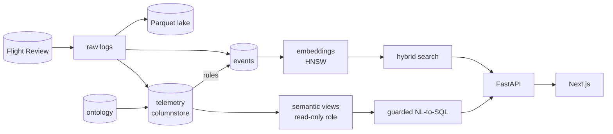
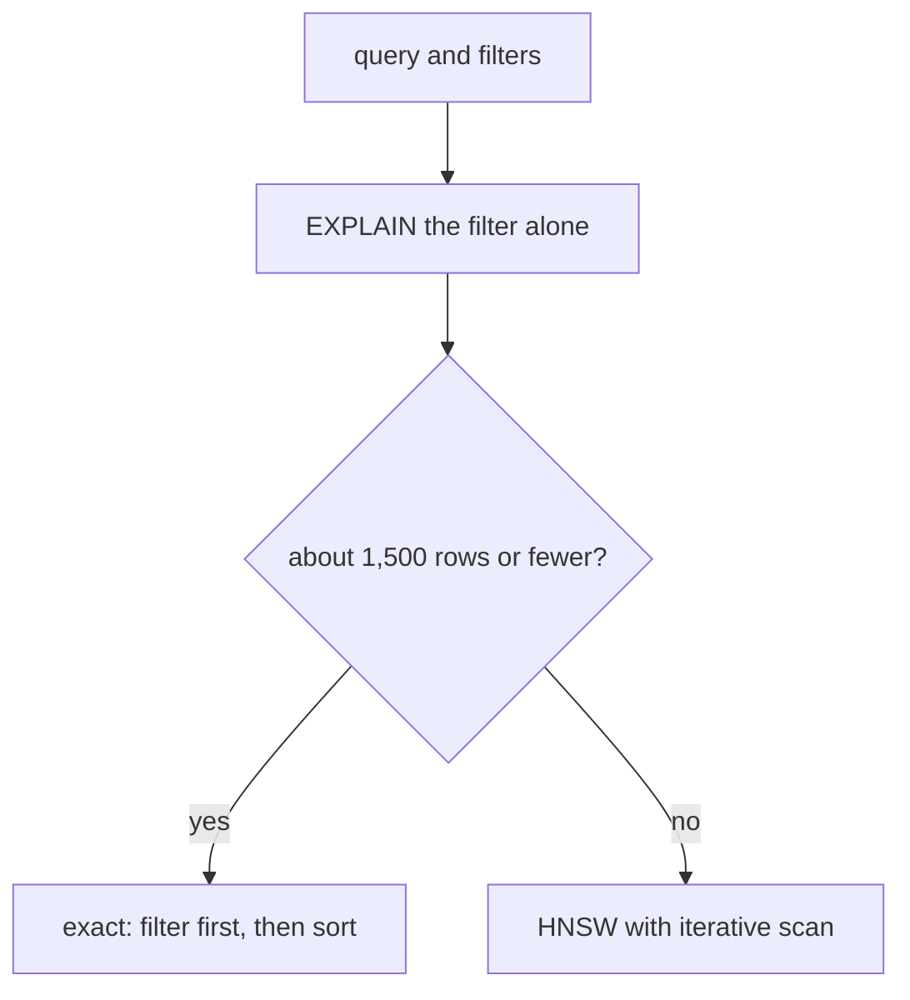
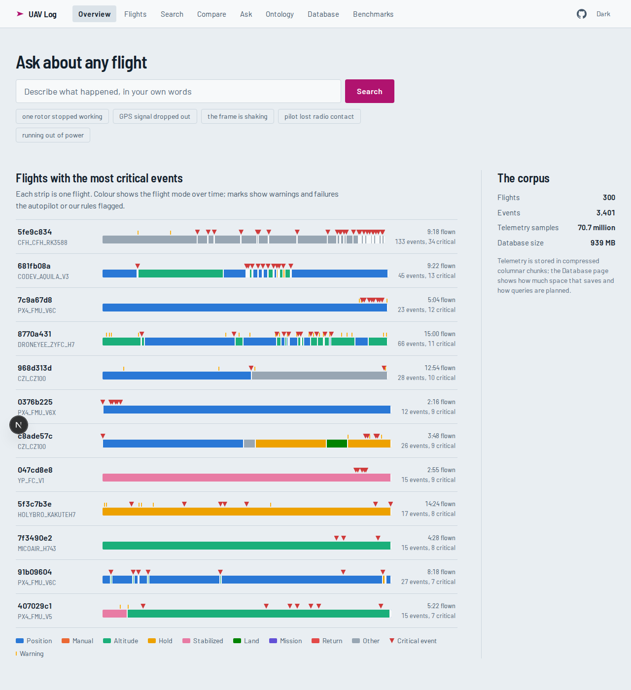
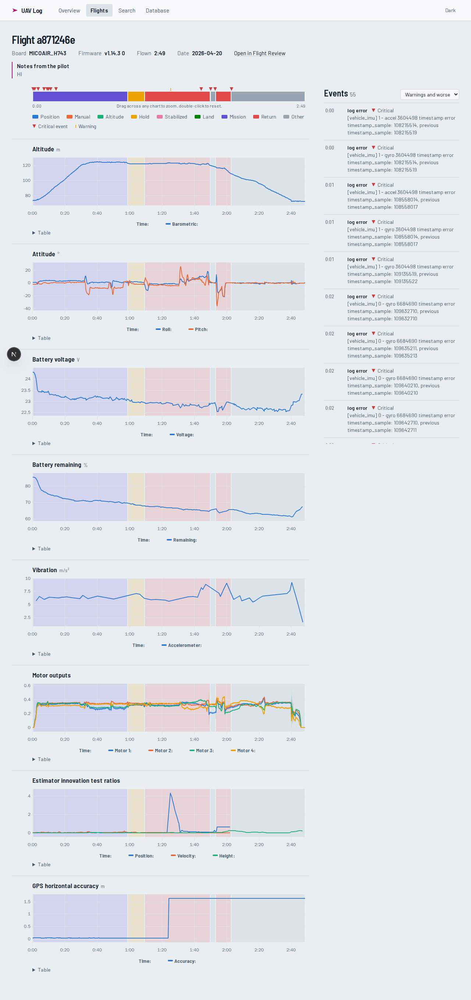
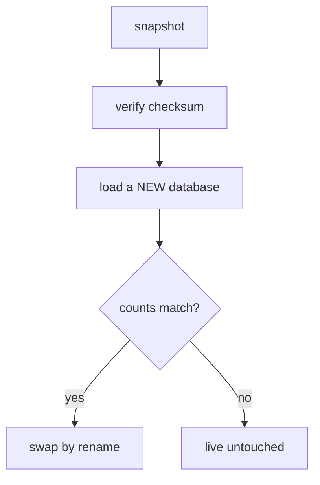

# Semantic Log Analytics for UAV Flight Logs

## A database-centred design and evaluation

Sumit Kumar &nbsp;·&nbsp; Advanced Database Management Systems

github.com/SumitKumar-17/UAVLog

---

## Flight logs are a database problem

- **300 real PX4 flights**: 70.7 million telemetry samples, 3,401 events
- Three kinds of data at once: **time series**, **text** (warnings, pilot notes), **vendor dialects** (PX4 and ArduPilot name things differently)
- People ask in words: *"which flights lost a motor?"*
- Existing tools plot **one log at a time**

To our knowledge, no published system combines an ontology, hybrid retrieval and guarded natural-language SQL over PX4 logs.

---

## Four questions, each answered by an experiment

1. **Storage.** How should high-rate telemetry be stored, and what does it cost?
2. **Retrieval.** Which vector index, how to filter, and does full-text fusion help?
3. **Natural-language access.** Can a model write safe, correct SQL, and what does a semantic layer add?
4. **Operations.** Does the pipeline survive bad input and scale from 300 to hundreds of thousands of logs?

Everything on one PostgreSQL instance: TimescaleDB for time series, pgvector for similarity.

---

## Data and method

- 478,918 public Flight Review logs, **300 chosen** (seeded, stratified): 8.75 GB, CC-BY
- 4 cores, 15 GB RAM, no GPU
- PostgreSQL 17.11, TimescaleDB 2.30.2, pgvector 0.8.7, pgvectorscale 0.9.1

**Rules I held myself to**

- Measure, do not assume
- Development set and a held-out set
- Intervals and paired tests, not single numbers
- **Report every mistake and its fix**

---

## Architecture

One database. Each batch stage is a Postgres job queue: idempotent, concurrent, retried, crash-recoverable.

---

## Storage: 32 times smaller

32×

12.46 GB → **0.38 GB**

176 → **5 bytes per row**

- Same 70.7 M samples, same query results (verified against the Parquet source)
- As rowstore the **index (7.6 GB) was larger than the table (4.9 GB)**
- Segmented by *(flight, signal)*, ordered by time
- Found by testing: inserting into a compressed chunk leaves it *partial*; our first compress stage skipped those

---

## Columnstore design experiment

100 flights, 26.9 M rows, median of 7 warm runs

| variant | size | Q1 one flight | Q2 all flights | Q3 flight | Q4 90 days |
|---|---|---|---|---|---|
| rowstore + B-tree | 3,631 MB | 10.8 ms | 1,519 ms | 65 ms | 246 ms |
| **segment (flight, signal), order ts** | **147 MB** | 12.3 ms | **16 ms** | 10.8 ms | **2.7 ms** |
| segment flight only | 149 MB | 12.9 | 18.0 | 11.6 | 3.2 |
| segment signal only | 154 MB | 13.0 | 20.3 | 14.1 | 2.2 |
| no segmentby | 157 MB | 15.0 | 29.7 | 13.7 | 3.6 |
| 1-day chunks | 150 MB | 16.3 | 15.3 | 12.3 | 3.4 |
| 30-day chunks | 143 MB | 9.2 | 8.3 | 5.7 | 2.4 |

25× smaller, up to 95× faster. Design choices change size by under 10%; chunk count and segmentby change cross-flight speed 2×.

---

## TimescaleDB against DuckDB

<<ENGINES-SLIDE>>

---

## The semantic layer

- **63 concepts, 55 relations**: 34 signals, 7 subsystems, 7 failure modes, 15 event kinds
- Each vendor field maps to a canonical signal with **scale, offset and a note**
- Queries use `battery.voltage`, not `battery_status.voltage_v`

**Second autopilot (ArduPilot MAVLink), mapped by hand**

- Mapped: attitude, GPS, position, velocity, battery
- **Deliberately not mapped**: vibration, motor outputs, EKF ratios, barometric altitude, flight mode, because they mean different things
- A wrong mapping is worse than a gap

---

## Events and how well the detectors work

- **3,401 events** from log transitions, the failure detector and gaps-and-islands rules
- Rules fire only against a **baseline in the same flight** (battery stuck at 0% is not an event)
- Repeated messages that differ only in numbers collapse: 3,846 → 3,401

<<INJECTION-SLIDE>>

---

## Search: the hybrid did not win

| method | nDCG@10 (65 queries) | hard paraphrases |
|---|---|---|
| vector only | **0.710** | 0.59 |
| vector + light full-text (0.1) | **0.709** | 0.59 |
| plain reciprocal rank fusion | 0.600 | 0.43 |
| full-text only | 0.48 | 0.31 |

- Plain fusion is **significantly worse**: paired -0.109, 95% CI [-0.172, -0.051]
- Ten exact-term lookups scored 1.000 for every method: no evidence full-text helps even there
- Cosine distances sit in a narrow 0.40 to 0.60 band: **no honest relevance cutoff**

---

## Vector indexes at 100,000 vectors

1,536 dimensions, 200 queries, exact search takes 362 ms

| index | build | size | fastest at recall ≥ 0.95 | ≥ 0.99 |
|---|---|---|---|---|
| HNSW m=16 | 56 s | 819 MB | 2.7 ms | not reached |
| **HNSW m=32** | 149 s | 819 MB | **2.4 ms** | **3.2 ms** |
| IVFFlat, 316 lists | **17 s** | 822 MB | 5.5 ms | 9.3 ms |
| IVFFlat, 100 lists | 8.5 s | 820 MB | 8.4 ms | 14.8 ms |
| DiskANN | 268 s | **68 MB** | not reached | not reached (max 0.74) |

HNSW is over 100× faster than exact search at 0.95 recall (362 ms to 2.7 ms); IVFFlat builds 3 to 17× faster; DiskANN is 12× smaller but loses recall.

---

## Does data difficulty change the winner?

<<SIGMA-SLIDE>>

---

## Filtered search: post-filtering fails

Rows returned out of 10 requested, 100,000 vectors, filter independent of the vector

| strategy | keeps 0.1% | 1% | 10% | 50% |
|---|---|---|---|---|
| HNSW post-filter, ef 40 | **0.0** | 0.4 | 4.1 | 10 |
| HNSW post-filter, ef 400 | 0.3 | 4.2 | 10 | 10 |
| HNSW iterative scan | 10 · 50 ms | 10 · 6.8 ms | 10 · 2.3 ms | 10 · 1.8 ms |
| **B-tree filter, exact sort** | **10 · 1.0 ms** | **10 · 7.0 ms** | 10 · 55 ms | 10 · 329 ms |

- Iterative scans fix the **row count**, not the base recall, and cost 50 ms at 0.1%
- Selective filter: exact sort wins. Unselective: HNSW wins. **Crossover near 1,000 rows**

---

## The planner picks wrong, so the search routes itself

**With both indexes present at a 10% filter, Postgres chose HNSW post-filtering:**

- 4.0 rows returned of 10
- recall **0.37**, in 1.6 ms

It is fast and wrong; the cost estimate cannot know it under-returns.

A filter correlated with the query (its own event kind) is harmless: every variant returned 10 rows. Partial indexes and partitions added nothing at this size.

---

## Natural-language SQL: four defences

1. **Guard**: `sqlglot`, one SELECT, table and function allow-lists, no nested or recursive WITH; **the SQL that runs is rebuilt from the parse tree**
2. **Role** that can read only documented views
3. **Read-only transaction**, 8 s timeout
4. **Cost admission**: planner estimate under 100,000

- Realistic questions plan under 5,000
- A telemetry self-join plans at **515 million**
- 46 hostile queries refused, each **for the intended reason**
- A fake model that obeys prompt injection is still stopped
- 19 tests

---

## Natural-language SQL: does the semantic layer help?

**Held-out accuracy (27 questions)**

| condition | strict EX |
|---|---|
| semantic views | **0.89** |
| raw tables + same docs | 0.70 |
| raw tables alone | 0.26 |

- **Documentation is the big effect**: 0.26 → 0.70 (12 questions to 0, p = 0.0005)
- The views add 0.19 more, but **not significant** (6 to 1, p = 0.125)
- Without docs the model rarely fails loudly: 17 of 27 answers confident and **wrong**
- Never fabricated an answer to an unanswerable question

First run overstated the gap (0.65 vs 0.24); my harness and guard had bugs. Fixed, frozen, re-run with identical prompts. Both runs are kept.

---

## Pipeline engineering: lessons that cost real bugs

- **`SKIP LOCKED` claimed 52 rows when asked for 25**: planner re-ran the subquery; fixed with a materialised CTE
- A transaction block after a read became a **savepoint**: nothing committed, run reported success
- Parallel HNSW build crashed: `maintenance_work_mem` exceeded container shared memory
- Two services from one codebase **drifted** apart; now one image
- A single garbage timestamp made a flight **10^13 seconds** long

All found by testing from a fresh connection or a real log, all logged with evidence in docs/decisions.md.

---

## The interface

A flight is a strip: a ribbon of flight modes with event marks. The same ribbon shades every chart behind the data.

---

## More than a viewer

- **Ask**: question → SQL → answer, with the query, cost and guard actions shown
- **Compare** two flights on one axis, even across autopilots
- **Ontology** explorer, **ground track**, **notes**, **CSV export**
- **Similar flights** by behaviour, not by text: <<SIGNATURE-LINE>>
- **Database page**: live compression, `EXPLAIN ANALYZE` of named queries, pipeline health

---

## Share it, scale it

- `./bin/snapshot` packs the database; no one re-ingests
- Big run: `TIER=k10 ./bin/uavlog stream`
- 10,000 logs ≈ **13 GB database**, 134 GB Parquet, 292 GB raw, **at least 17 h** of polite downloads
- Then re-run every benchmark at scale

---

## What went wrong, and was fixed

- My **comparison treated numbers as strings**: part of the first accuracy gap was mine
- My **guard rejected a safe operator**: it unfairly penalised the baseline
- A prompt rule of mine made the model **count flights when asked for events**
- Suspected the synthetic data was too easy; **measured it: harder than the real corpus**
- Believed hybrid search would win; **the data said no**

Each is in the decision log with its numbers. The report shows corrections, not only results.

---

## Limits and future work

**Limits**

- 300 flights, one 4-core machine
- One language model, one run
- Event thresholds are heuristics
- Questions written by the system's author
- Index benchmark vectors are scaled-up copies

**Next**

- The large run, then every benchmark again
- ArduPilot at scale to test the ontology
- Real simulator fault ground truth
- A stronger and a weaker model
- A concurrency benchmark

---

## Key numbers

- **32×** smaller telemetry
- **up to 95×** faster cross-flight queries
- **over 100×** faster than exact search at 0.95 recall
- **0.89** NL-to-SQL accuracy on held-out questions

- **0.600 vs 0.710**: plain rank fusion hurts
- **4 of 10 rows**: the planner's wrong choice at a 10% filter
- **515 million**: the plan cost the admission check refuses
- **19 tests**, every decision logged

---

## Backup: how the benchmarks were run

- One connection, warm cache, one warm-up pass then 3 measured passes (vectors) or the median of 7 runs (storage)
- Recall against exact search (sequential scan, all indexes off); 200 held-out queries; top 10
- `shared_buffers` 3,968 MB, `maintenance_work_mem` 1,500 MB, 3 parallel build workers; container shared memory 3 GB
- Vector data: real event embeddings sampled with replacement and perturbed; relative contrast RC10 6.2 (σ 0.35), 2.0 (σ 0.8), real corpus 20.5
- The machine was otherwise idle; results and scripts in `bench/` and `backend/scripts/bench_*.py`

---

## Backup: filtered search, filter correlated with the query

| strategy | common kind | medium | rare |
|---|---|---|---|
| HNSW post-filter, ef 40 | R 0.92 · 1.2 ms | R 0.66 · 1.9 ms | R 1.00 · 1.2 ms |
| HNSW post-filter, ef 400 | 0.99 · 2.7 ms | 0.95 · 7.8 ms | 1.00 · 2.8 ms |
| B-tree filter, exact sort | 1.00 · 145 ms | 1.00 · 44 ms | 1.00 · 8.5 ms |
| partial HNSW per kind | 0.91 · 1.5 ms | 0.66 · 2.1 ms | 1.00 · 1.3 ms |
| list partitions + HNSW | 0.93 · 1.5 ms | 0.66 · 2.1 ms | 1.00 · 0.8 ms |
| DiskANN with labels | 0.77 · 5.0 ms | 0.46 · 8.5 ms | 1.00 · 4.1 ms |

Builds: HNSW 62 s, partial indexes 62 s in total, partitions 101 s, DiskANN with labels 621 s.

---

## Backup: tests and reproducibility

- 19+ automated tests: guard (46 hostile, 18 legitimate queries), pipeline with a fake obedient model, rate limiter, embedding cache, MAVLink parser
- GitHub Actions: guard tests, migrations on an empty database, web type check and build
- Every decision with its evidence: `docs/decisions.md` (D1 to D18)
- `./bin/uavlog all` rebuilds everything from the public index; `./bin/snapshot` shares the result
- Prompt component hashes recorded in every NL-to-SQL result file
